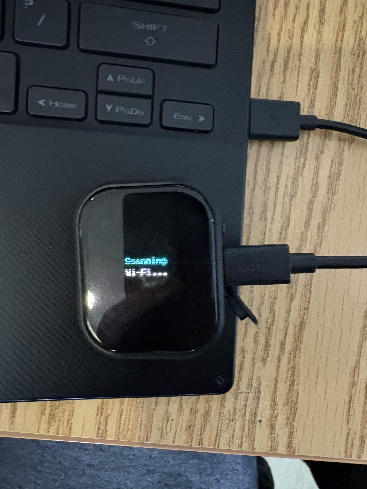
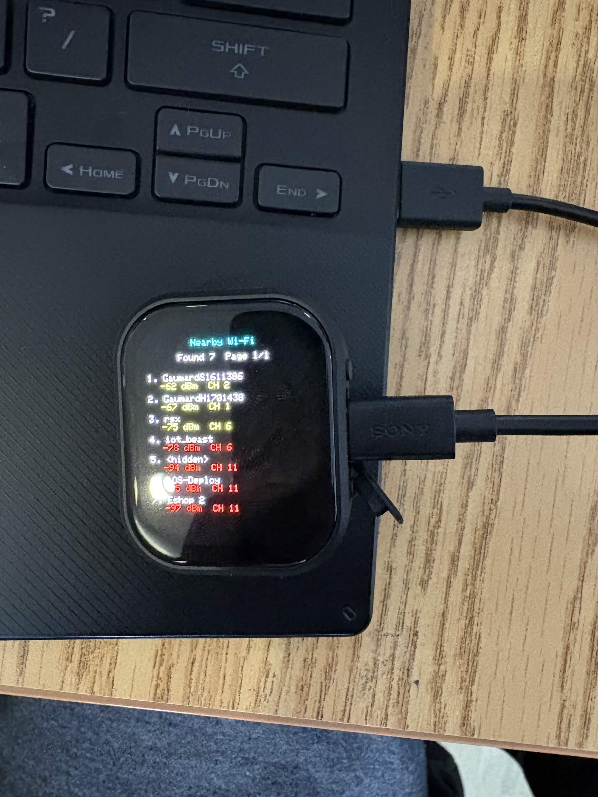
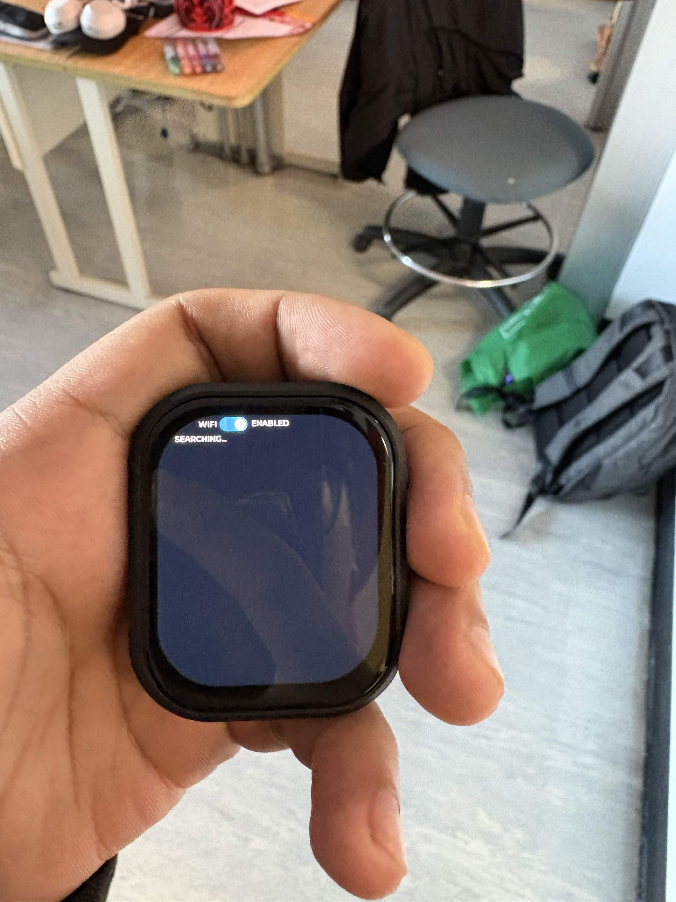
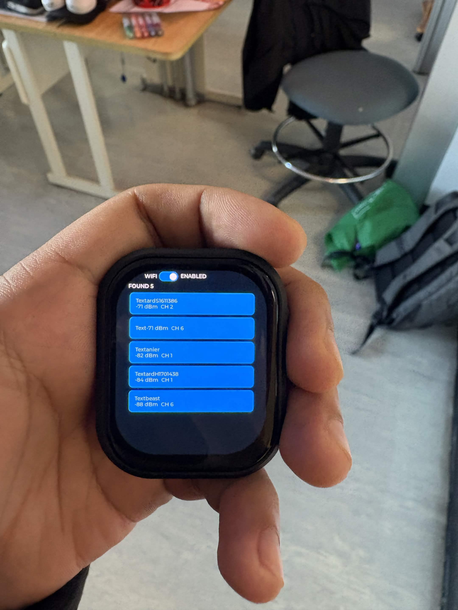

# Research Photos: ESP32 Watch Wi-Fi Prototypes

This directory stores physical-watch photos for two Wi-Fi interface versions
on the Waveshare ESP32-S3-Touch-AMOLED-2.06.

## Version 1: basic Arduino_GFX scanner

The basic source in
`src/watch/version-1-basic-wifi/watch_wifi_scan_test.cpp` scans nearby 2.4 GHz
networks and displays SSID, RSSI, and channel information in paged results.

### What Version 1 does

1. Starts the AMOLED display.
2. Puts the ESP32-S3 Wi-Fi radio in station mode.
3. Shows a scanning screen while it searches for nearby networks, including hidden networks.
4. Displays up to seven networks per page.
5. Automatically changes pages every five seconds and starts a new scan after the last page.
6. Prints the same scan details to the USB Serial Monitor.





## Version 2: SquareLine/LVGL touch interface

Version 2 is packaged in
`src/watch/version-2-squareline-wifi/`. The user reports that it was flashed to
and run on the physical watch. The photos below show the enabled touch switch,
the asynchronous searching state, and five results displayed as a scrollable
LVGL button list.





Version 2 displays up to 24 results, including RSSI and channel, and lets the
user touch a result to select it. This is physical subsystem evidence, not
evidence that the final rover link, survey map, environmental summary, anomaly
indicator, or five-second delivery is complete.

The preserved V2 source package also passed a fresh isolated Arduino CLI build
using the documented board target, dependencies, and command. The tested
original sketch, packaged sketch, and reference copy have matching hashes. This
verifies the V2 subsystem package build, not the clean build of the future
integrated rover/watch firmware required by REQ-RS-08.

## Understanding the Wi-Fi output

- `Found` is the total number of networks detected during the scan.
- `Page` shows the current results page and the total number of pages.
- The network name is the SSID. A network that does not broadcast its name
  appears as `<hidden>`. Hidden access points omit the SSID from the beacon
  information used by passive scans, so the watch cannot recover that name
  without the SSID being supplied or learned through an authorized connection.
- `dBm` is received signal strength. A value closer to 0 is stronger. The display uses green for strong signals, yellow for medium signals, and red for weak signals.
- `CH` is the 2.4 GHz Wi-Fi channel used by the network.

## Wi-Fi limitation

The ESP32-S3 radio in this watch supports 2.4 GHz Wi-Fi only. It cannot detect or connect to a 5 GHz-only network. A dual-band router or phone hotspot must have its 2.4 GHz band enabled for the watch to find it.

## Libraries and files

- `Arduino.h` provides the standard Arduino functions and types.
- `WiFi.h` comes with the Espressif ESP32 Arduino board package and performs the network scan.
- `Arduino_GFX_Library.h` is the Waveshare-provided Arduino_GFX library used to drive the CO5300 AMOLED display.
- `HWCDC.h` comes with the ESP32 Arduino board package and provides USB serial output.
- `src/watch/version-1-basic-wifi/watch_wifi_scan_test.cpp` contains the Version 1 scan test.
- `src/watch/version-1-basic-wifi/pin_config.h` is a local board header containing the display pin numbers, screen size, and other board pin definitions. It is not an Arduino Library Manager package.
- `src/watch/version-2-squareline-wifi/` contains the Version 2 sketch,
  SquareLine/LVGL sources, local configuration, and full dependency inventory.

## File structure

```text
remote-environmental-survey/
|-- src/
|   `-- watch/
|       |-- version-1-basic-wifi/
|       |   |-- README.md
|       |   |-- watch_wifi_scan_test.cpp
|       |   `-- pin_config.h
|       `-- version-2-squareline-wifi/
`-- photos/
    |-- README.md
    `-- images/
        |-- v1-wifi-scan-results.png
        |-- v1-wifi-scanning-screen.png
        |-- v2-squareline-wifi-scan-results.png
        `-- v2-squareline-wifi-searching.png
```

## Basic Arduino IDE use

1. Install the Espressif ESP32 board package in Arduino IDE.
2. Install the Waveshare version of Arduino_GFX supplied with the official ESP32-S3-Touch-AMOLED-2.06 examples.
3. Create an Arduino sketch and copy the contents of `src/watch/version-1-basic-wifi/watch_wifi_scan_test.cpp` into the sketch's `.ino` file.
4. Copy `src/watch/version-1-basic-wifi/pin_config.h` into the same sketch folder.
5. Select `ESP32S3 Dev Module`, the watch's COM port, OPI PSRAM, and the correct flash settings for the board.
6. Upload the sketch. Open Serial Monitor at 115200 baud to see the full scan results.

See `src/watch/README.md` for the boundary between Version 1, Version 2, and the
still-unfinished final watch functions.
